# Multi-Agent Worktree Collaboration Workflow

This document outlines the operational lifecycle for coordinating **Google Antigravity**, **OpenAI Codex**, and **Anthropic Claude** using Git Worktrees.

---

## The Triad Pipeline Overview

```mermaid
flowchart TD
    User([User Request / Feature Goal]) --> A[1. Antigravity: Architecture & Task Breakdown]
    
    subgraph Plan_Phase [Phase 1: Architecture]
        A --> A1[Create Technical Spec / API Contracts]
        A1 --> A2[Update .agent/TASK_BOARD.md]
        A2 --> A3[Commit Contracts to main]
    end

    A3 --> B[2. Codex: Scaffolding & Test Generation]
    
    subgraph Build_Phase [Phase 2: Implementation & Tests]
        B --> B1[Sync worktree: git rebase main]
        B1 --> B2[Generate Boilerplate, Models & Endpoints]
        B2 --> B3[Write Comprehensive Unit & Fuzz Tests]
        B3 --> B4[Implement Security & Schema Validations]
        B4 --> B5[Commit to agent/codex]
    end

    B5 --> C[3. Claude: Logic Refinement & Adversarial Review]
    
    subgraph Refine_Phase [Phase 3: Core Logic & Review]
        C --> C1[Pull / Rebase codex changes]
        C1 --> C2[Implement Complex Business Logic & Edge Cases]
        C2 --> C3[Adversarial Code Review & Security Audit]
        C3 --> C4[Execute Autonomous Test/Fix Loop]
        C4 --> C5[Commit to agent/claude]
    end

    C5 --> D[4. Antigravity: UI Integration & Final Release]

    subgraph Release_Phase [Phase 4: Verification & Merge]
        D --> D1[Build Frontend UI & Wire Components]
        D1 --> D2[Visual QA & Browser Testing]
        D2 --> D3[Merge Branch into main]
        D3 --> D4[Mark Task Complete on TASK_BOARD.md]
    end
```



---

## Step-by-Step Execution Guide

### Phase 1: Planning & Specification (Antigravity)
1. **Location:** Root directory or `.worktrees/antigravity`
2. **Action:**
   - Digest customer requirements, existing documents, or external APIs.
   - Author the interface types (e.g., `src/types/`, OpenAPI spec, database migration stubs).
   - Create entries in `.agent/TASK_BOARD.md`.
   - Commit and push to `main`:
     ```powershell
     git add .
     git commit -m "spec: define auth & billing contracts [Antigravity]"
     ```

### Phase 2: Rapid Implementation & Tests (Codex)
1. **Location:** `.worktrees/codex`
2. **Action:**
   - Sync with latest `main`:
     ```powershell
     git rebase main
     ```
   - Scaffold the concrete implementations (ORM models, controller routes, validation schemas).
   - Write unit test suites and mock data.
   - Verify tests pass locally:
     ```powershell
     npm test # or pytest
     ```
   - Commit changes to `agent/codex`:
     ```powershell
     git add .
     git commit -m "feat(scaffold): implement billing routes & unit tests [Codex]"
     ```
   - Update `.agent/TASK_BOARD.md` marking task status as `Ready for Review`.

### Phase 3: Core Logic & Adversarial Review (Claude)
1. **Location:** `.worktrees/claude`
2. **Action:**
   - Merge or cherry-pick Codex's branch:
     ```powershell
     git pull origin agent/codex --rebase
     # or git merge agent/codex
     ```
   - Inspect code for subtle bugs, race conditions, edge cases, and performance bottlenecks.
   - Implement complex domain logic, transaction safety, and error handling.
   - Run autonomous verification loop until test suite and linters are 100% clean:
     ```powershell
     claude
     # Claude runs: Plan -> Edit -> Test -> Fix
     ```
   - Commit verified code to `agent/claude`:
     ```powershell
     git commit -m "refactor(core): verify billing logic & race safety [Claude]"
     ```

### Phase 4: UI Integration & Verification (Antigravity)
1. **Location:** `.worktrees/antigravity` or root repo
2. **Action:**
   - Merge `agent/claude` into `agent/antigravity`:
     ```powershell
     git merge agent/claude
     ```
   - Wire the backend services into frontend UI components.
   - Launch local dev server on isolated port (e.g. `PORT=3000 npm run dev`).
   - Use Antigravity's visual browser to inspect DOM, test responsive styling, and confirm zero console warnings.
   - Merge into `main` and tag the release:
     ```powershell
     git checkout main
     git merge agent/antigravity --no-ff -m "feat: complete billing module release [Triad]"
     ```

---

## Port Allocation Matrix

To prevent port collisions when multiple agents run dev servers or test runners at the same time:

| Agent / Worktree | Dev Server Port | Test / Mock Server Port | DB / Scratch Port |
| :--- | :---: | :---: | :---: |
| **Main / Coordinator** | `3000` | `3090` | `5432` |
| **Antigravity Worktree** | `3001` | `3091` | `5433` |
| **Claude Worktree** | `3002` | `3092` | `5434` |
| **Codex Worktree** | `3003` | `3093` | `5435` |
